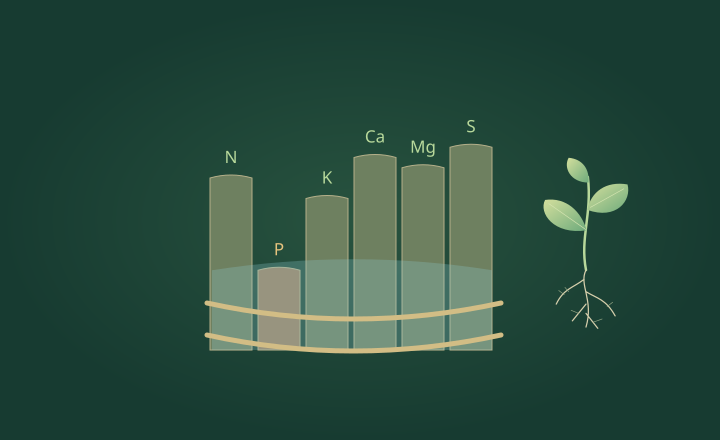
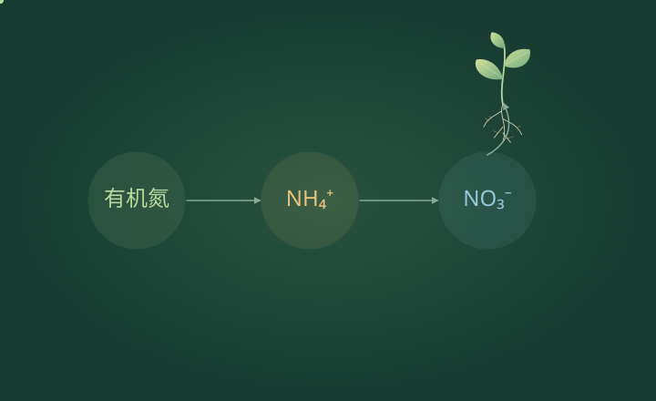
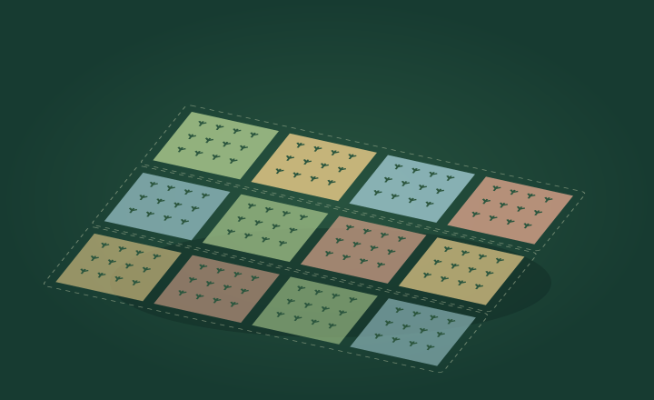
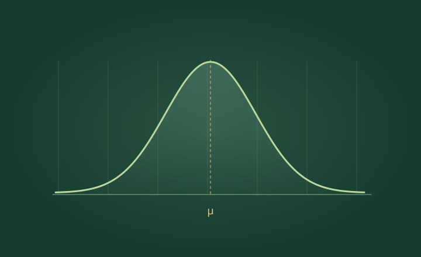
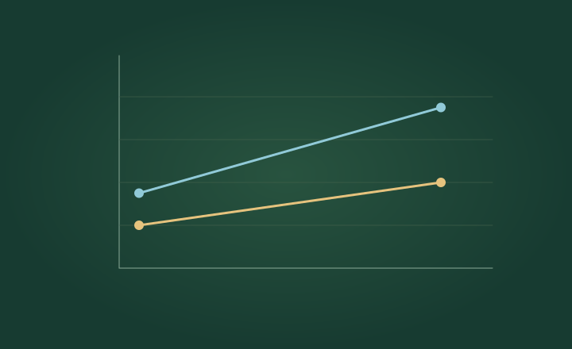

# 植知 · 植物营养与试验统计互动教学

黄利东 · 内蒙古农业大学

把一个知识点，做成可以观察、操作、分步播放的演示。

**在线体验：[https://lidong-huang.github.io/plant-nutrition-lab/](https://lidong-huang.github.io/plant-nutrition-lab/)**

## 教学资源

| 封面 | 课件 | 知识路径 | 文件 |
| --- | --- | --- | --- |
|  | [根系如何吸收养分](https://lidong-huang.github.io/plant-nutrition-lab/lessons/uptake.html) | 土壤溶液 → 根表 → 吸收 → 运输 | [独立 HTML](dist/downloads/uptake.html) |
|  | [最小养分律](https://lidong-huang.github.io/plant-nutrition-lab/lessons/minimum.html) | 供给 → 短板 → 补氮 → 平衡 | [独立 HTML](dist/downloads/minimum.html) |
|  | [土壤中的氮素转化](https://lidong-huang.github.io/plant-nutrition-lab/lessons/nitrogen.html) | 有机氮 → 矿化 → 硝化 → 去向 | [独立 HTML](dist/downloads/nitrogen.html) |
|  | [随机区组设计](https://lidong-huang.github.io/plant-nutrition-lab/lessons/blocks.html) | 梯度 → 区组 → 随机 → 重复 | [独立 HTML](dist/downloads/blocks.html) |
|  | [正态分布](https://lidong-huang.github.io/plant-nutrition-lab/lessons/normal.html) | 形状 → 对称 → 均值 → 标准差 → 拐点 → 概率 | [独立 HTML](dist/downloads/normal.html) |
|  | [氮 × 磷的交互作用](https://lidong-huang.github.io/plant-nutrition-lab/lessons/interaction.html) | 因素 → 无交互 → 正交互 → 对比 | [独立 HTML](dist/downloads/interaction.html) |

## 使用

- **在线**：首页选择课件，按步骤播放或调整参数。
- **离线**：下载 `dist/downloads/` 内任意 HTML，在 Chrome 或 Edge 中直接打开。
- **本地**：双击 `dist/index.html`；或执行 `npm start`，访问 `http://127.0.0.1:4173`。
- **投影**：课件右上角进入全屏；左右方向键翻步，空格播放 / 暂停（焦点在参数控件时优先操作控件）。

## 目录

```text
dist/
  index.html          # 资源首页
  catalog.json        # 课程目录
  covers/             # 原创 SVG 封面
  lessons/            # 在线课程
  downloads/          # 可独立运行的离线 HTML
  assets/             # 样式、动画与模型
scripts/              # 生成、校验、本地预览
docs/                 # 发布、内容依据与维护说明
.github/workflows/    # GitHub Pages 自动部署
```

修改后运行 `npm run build` 与 `npm run check`。添加课件见 [维护说明](docs/维护说明.md)，首次上线见 [GitHub 发布](docs/GitHub发布.md)。

## 模型与来源

图形与新课件为独立编写的 SVG / JavaScript 教学示意；正态分布沿用本地已有课程。数值为教学设定，非真实试验结果。最小养分律使用相对满足度最小值；交互作用采用可调的四格均值模型，不据此判断统计显著性。详见 [内容依据](docs/内容依据.md)。

资源组织方式参考 [Tongjiang Lab](https://github.com/smithjohn78390/tongjiang-lab)，未复制其代码、封面或课程素材。当前项目未额外授予开源许可；公开使用与再分发方式由作者确定。
