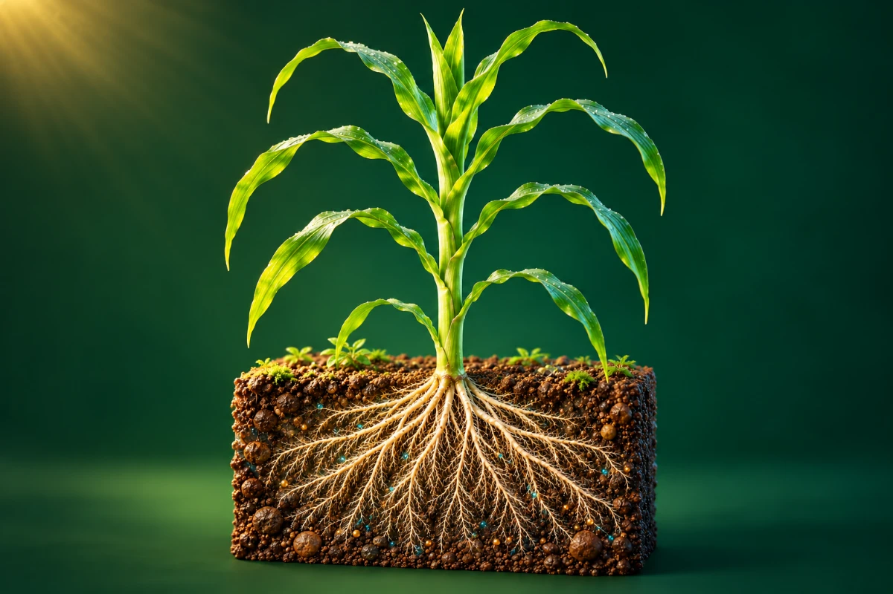
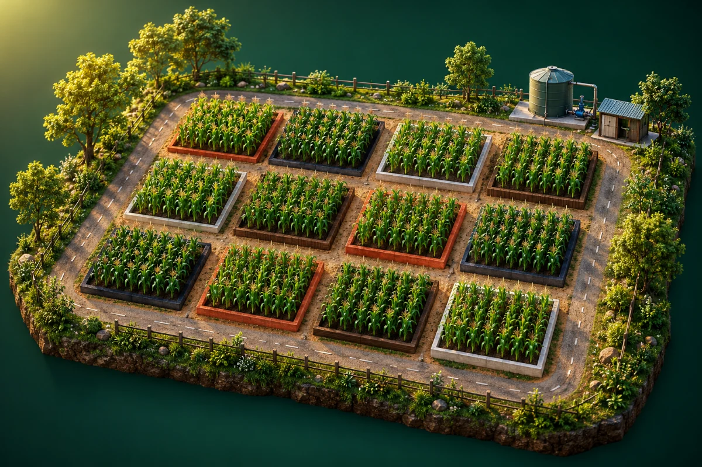
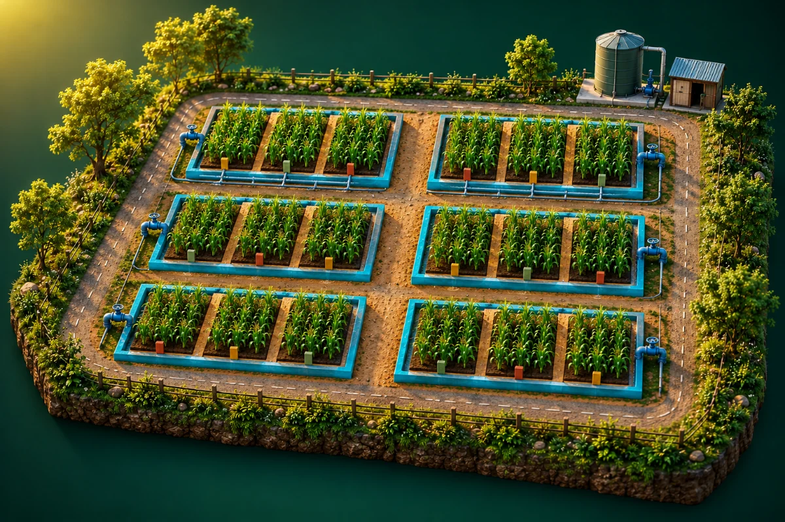
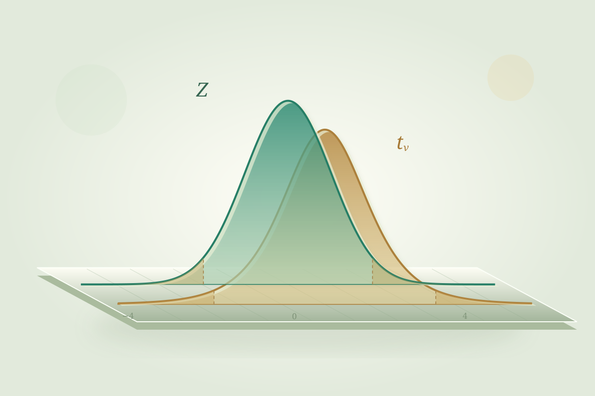
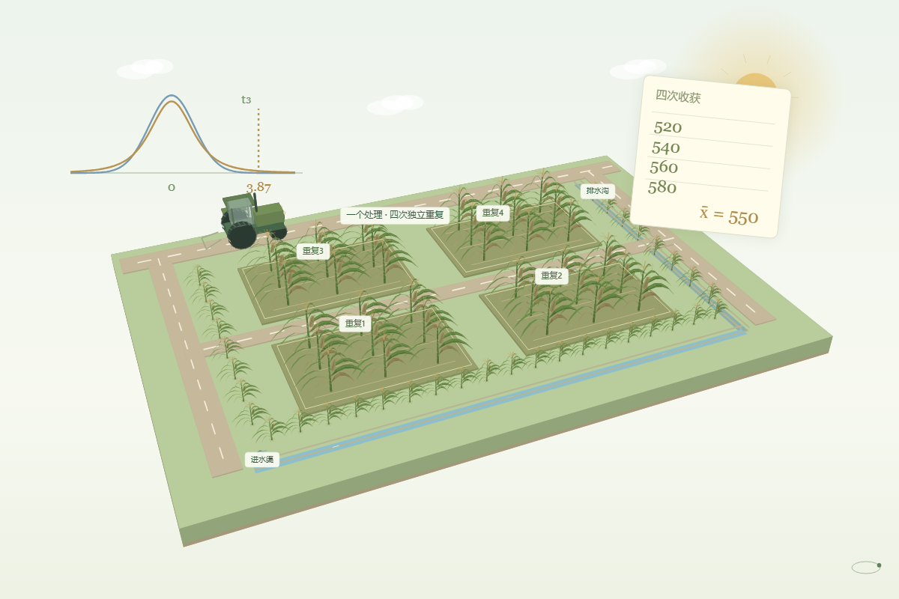
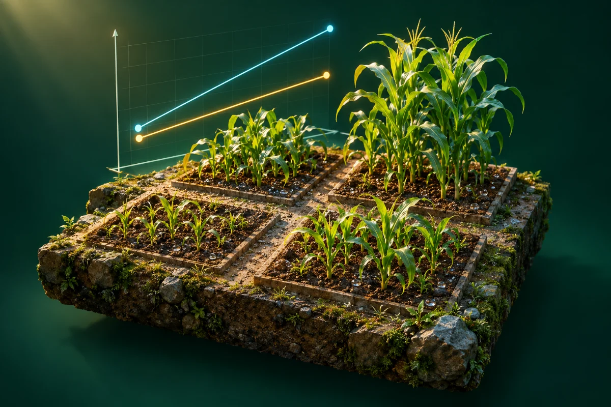
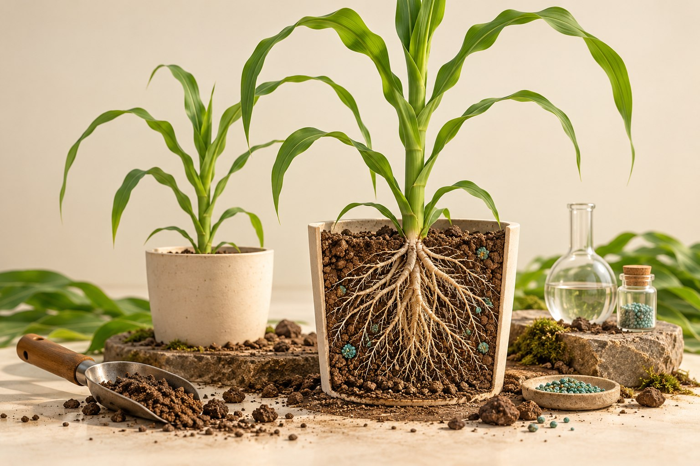
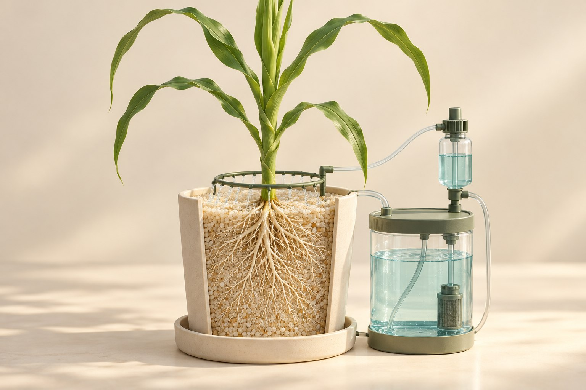
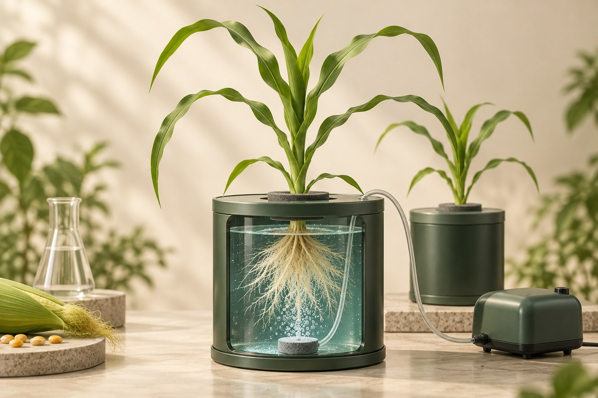
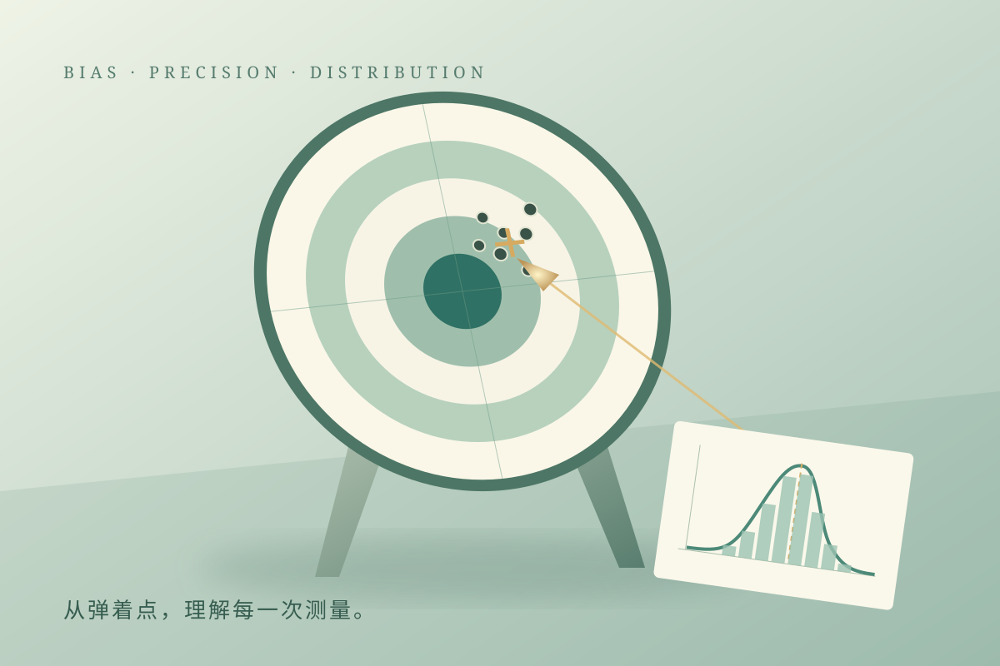

# 植知 · 植物营养与试验统计互动教学

黄利东 · 内蒙古农业大学

把一个知识点，做成可以旋转、操作、分步播放的立体演示。

**在线体验：[https://lidong-huang.github.io/plant-nutrition-lab/](https://lidong-huang.github.io/plant-nutrition-lab/)**

## 教学资源

已整理 **13 项定稿资源**：植物营养 3 项、培养试验 3 项、田间试验 2 项、试验统计 5 项。

[按分类查看目录](courses/README.md) · [完整文件清单](docs/资源目录.md) · [下载整个资源库 ZIP](https://github.com/Lidong-Huang/plant-nutrition-lab/archive/refs/heads/main.zip)

| 封面 | 课件（在线演示） | 知识路径 | 文件与说明 |
| --- | --- | --- | --- |
|  | [根系如何吸收养分](https://lidong-huang.github.io/plant-nutrition-lab/lessons/uptake.html) | 土壤 → 根表 → 吸收 → 运输 | [独立 HTML](dist/downloads/uptake.html) · [说明](courses/uptake/README.md) |
|  | [最小养分律](https://lidong-huang.github.io/plant-nutrition-lab/lessons/minimum.html) | 植株生长 → 木桶短板 → 限制转移 | [独立 HTML](dist/downloads/minimum.html) · [说明](courses/minimum/README.md) |
|  | [土壤中的氮素转化](https://lidong-huang.github.io/plant-nutrition-lab/lessons/nitrogen.html) | 矿化与硝化 → 吸收 → 三类氮损失 | [独立 HTML](dist/downloads/nitrogen.html) · [说明](courses/nitrogen/README.md) |
|  | [随机区组设计](https://lidong-huang.github.io/plant-nutrition-lab/lessons/blocks.html) | 肥力梯度 → 区组 → 随机与重复 | [独立 HTML](dist/downloads/blocks.html) · [说明](courses/blocks/README.md) |
|  | [裂区试验设计](https://lidong-huang.github.io/plant-nutrition-lab/lessons/splitplot.html) | 灌水主区 → 施肥副区 → 两层误差 | [独立 HTML](dist/downloads/splitplot.html) · [说明](courses/splitplot/README.md) |
|  | [正态分布](https://lidong-huang.github.io/plant-nutrition-lab/lessons/normal.html) | X 与 X̄ → 抽样分布 → 两者标准化 → 累积概率与积分 | [独立 HTML](dist/downloads/normal.html) · [说明](courses/normal/README.md) |
|  | [t 分布与标准正态分布](https://lidong-huang.github.io/plant-nutrition-lab/lessons/t-normal.html) | 形状 → 自由度 → 双尾 0.05 → 临界值 | [独立 HTML](dist/downloads/t-normal.html) · [说明](courses/t-normal/README.md) |
|  | [这次玉米产量显著提高了吗？](https://lidong-huang.github.io/plant-nutrition-lab/lessons/trial-story.html) | 四个小区 → 均值抽样 → 标准化与t → 尾部概率 → 判断 | [独立 HTML](dist/downloads/trial-story.html) · [说明](courses/trial-story/README.md) |
|  | [氮 × 磷的交互作用](https://lidong-huang.github.io/plant-nutrition-lab/lessons/interaction.html) | 两个因素 → 交互作用 → 对比 | [独立 HTML](dist/downloads/interaction.html) · [说明](courses/interaction/README.md) |
|  | [土培 · 玉米磷肥效应](https://lidong-huang.github.io/plant-nutrition-lab/lessons/soil-culture.html) | 装盆与磷处理 → 养护 → 收获评价 | [独立 HTML](dist/downloads/soil-culture.html) · [说明](courses/soil-culture/README.md) |
|  | [砂培 · 自动砂面浇灌](https://lidong-huang.github.io/plant-nutrition-lab/lessons/sand-culture.html) | 洗砂与配液 → 自动浇灌 → 收获评价 | [独立 HTML](dist/downloads/sand-culture.html) · [说明](courses/sand-culture/README.md) |
|  | [水培 · 霍格兰供磷试验](https://lidong-huang.github.io/plant-nutrition-lab/lessons/hydro-culture.html) | 霍格兰配液 → pH 与通气 → 供磷评价 | [独立 HTML](dist/downloads/hydro-culture.html) · [说明](courses/hydro-culture/README.md) |
|  | [误差 · 准确度与精确度](https://lidong-huang.github.io/plant-nutrition-lab/lessons/measurement-error.html) | 农业测量 → 打靶 → 两类误差 → 分布 | [独立 HTML](dist/downloads/measurement-error.html) · [说明](courses/measurement-error/README.md) |

## 使用

- **在线**：首页选择课件，按步骤播放或调整参数。
- **闯关**：[这次玉米产量显著提高了吗？](https://lidong-huang.github.io/plant-nutrition-lab/lessons/trial-story.html) 包含五幕、十五个必做任务；完成操作和选择后才能继续，支持本地进度保存与学习记录下载。
- **旋转**：拖动观察立体场景，滚轮缩放；触屏单指旋转、双指缩放。支持正视、俯视、复位和自动环绕。
- **动画**：观察养分流动、木桶水位、作物响应和区组随机移动；田间场景包含日照、道路、树木与作物。
- **离线**：下载 `dist/downloads/` 内任意 HTML，在 Chrome 或 Edge 中直接打开。
- **本地**：双击 `dist/index.html`；或执行 `npm start`，访问 `http://127.0.0.1:4173`。
- **投影**：右上角进入全屏。画布外左右方向键翻步，空格自动演示；画布聚焦时方向键旋转，+ / - 缩放，0 复位视角。

## 目录

```text
courses/             # 各资源独立目录与 README
dist/
  index.html          # 资源首页
  catalog.json        # 课程目录
  covers/             # 课程封面（WebP / SVG）
  lessons/            # 在线课程
  downloads/          # 可独立运行的离线 HTML
  assets/             # 样式、动画与模型
scripts/              # 生成、校验、本地预览
docs/                 # 发布、内容依据与维护说明
.github/workflows/    # GitHub Pages 自动部署
```

修改后运行 `npm run build` 与 `npm run check`。添加课件见 [维护说明](docs/维护说明.md)，首次上线见 [GitHub 发布](docs/GitHub发布.md)。

## 模型与来源

新课件采用独立编写的 Canvas 立体几何和粒子动画，首页采用原创生成的立体科学封面；正态分布沿用本地已有课程。数值、植物高度与环境均为教学设定，非真实试验结果。最小养分律将植物生长与木桶联动，模型和情景见 [最小养分律说明](docs/最小养分律说明.md)；交互作用采用可调的四格均值模型，不据此判断统计显著性。裂区试验的过程与统计结构见 [裂区试验说明](docs/裂区试验说明.md)。氮素各过程、损失出口与演示边界见 [氮素转化机理](docs/氮素转化机理.md)。详见 [内容依据](docs/内容依据.md) 与 [封面设计](docs/封面设计.md)。

资源组织方式参考 [Tongjiang Lab](https://github.com/smithjohn78390/tongjiang-lab)，未复制其代码、封面或课程素材。当前项目未额外授予开源许可；公开使用与再分发方式由作者确定。


有合作需要可以联系我：[ldhuangnz@163.com](mailto:ldhuangnz@163.com)。
