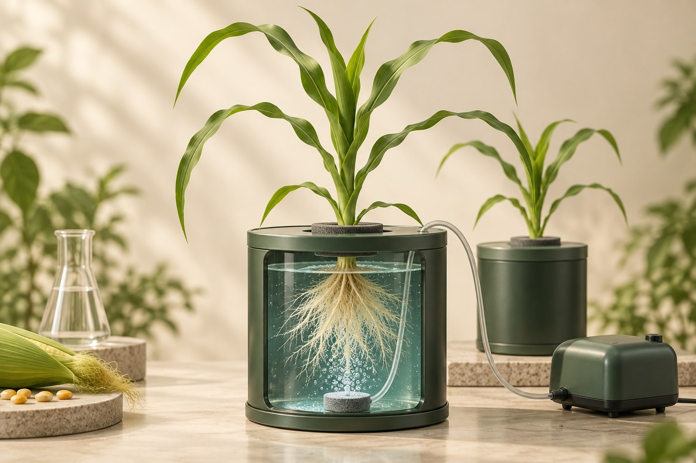

# 水培 · 霍格兰供磷试验

**[在线演示](https://lidong-huang.github.io/plant-nutrition-lab/lessons/hydro-culture.html)** · [独立 HTML](../../dist/downloads/hydro-culture.html) · [课程目录](../README.md)

用改良半量霍格兰营养液，串起磷钾配平、通气换液与取样。

步骤：问题与对照 → 配制霍格兰液 → 磷与钾配平 → 育苗与定植 → 随机与重复 → pH 与通气管理 → 成熟收获与千粒重 → 吸磷量与解释。

[内容与模型说明](../../docs/霍格兰配液与pH操作.md) · [课件源码](../../dist/lessons/hydro-culture.html)
