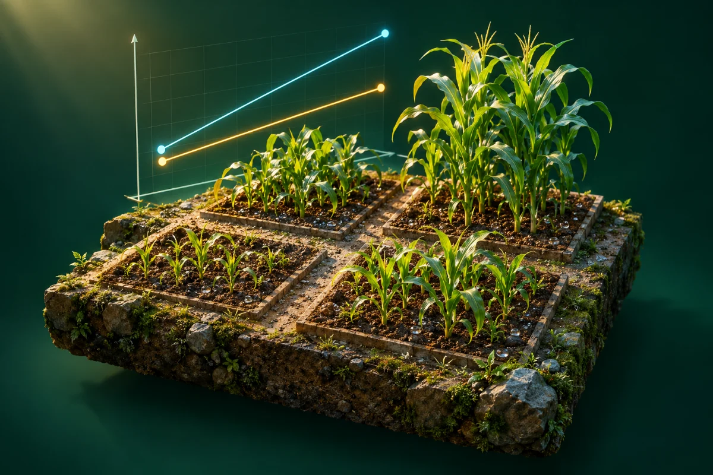

# 氮 × 磷的交互作用

**[在线演示](https://lidong-huang.github.io/plant-nutrition-lab/lessons/interaction.html)** · [独立 HTML](../../dist/downloads/interaction.html) · [课程目录](../README.md)

让两条响应线动起来，区分独立效应与交互作用。

步骤：两个因素 → 无交互 → 正交互 → 解释差异。

[内容与模型说明](../../docs/内容依据.md) · [课件源码](../../dist/lessons/interaction.html)
