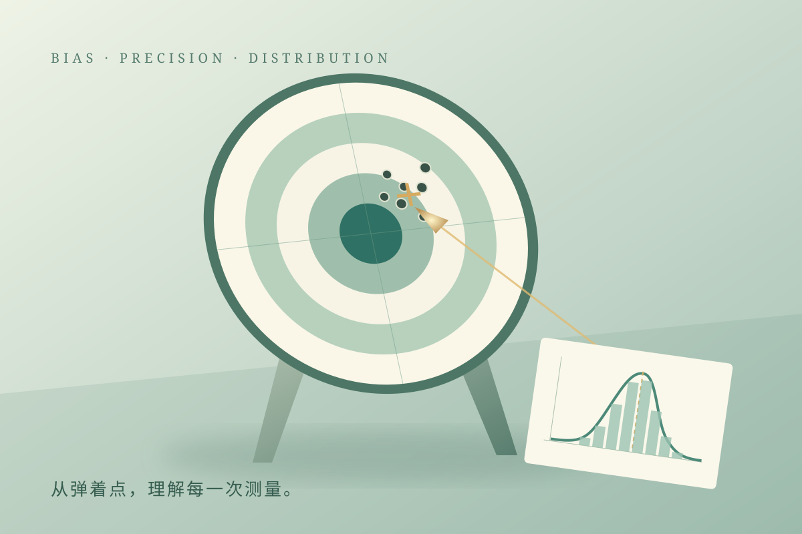

# 误差 · 准确度与精确度

**[在线演示](https://lidong-huang.github.io/plant-nutrition-lab/lessons/measurement-error.html)** · [独立 HTML](../../dist/downloads/measurement-error.html) · [课程目录](../README.md)

从玉米试验的测磷读数出发，用保留弹孔的打靶与分布平移动画，理解误差、准确度与精确度。

步骤：农业试验 → 定义误差 → 测量到打靶 → 两类误差 → 准确与精确 → 观测与误差分布 → 随机误差分布 → 重复与均值 → 回到试验。

[内容与模型说明](../../docs/误差与测量.md) · [课件源码](../../dist/lessons/measurement-error.html)
