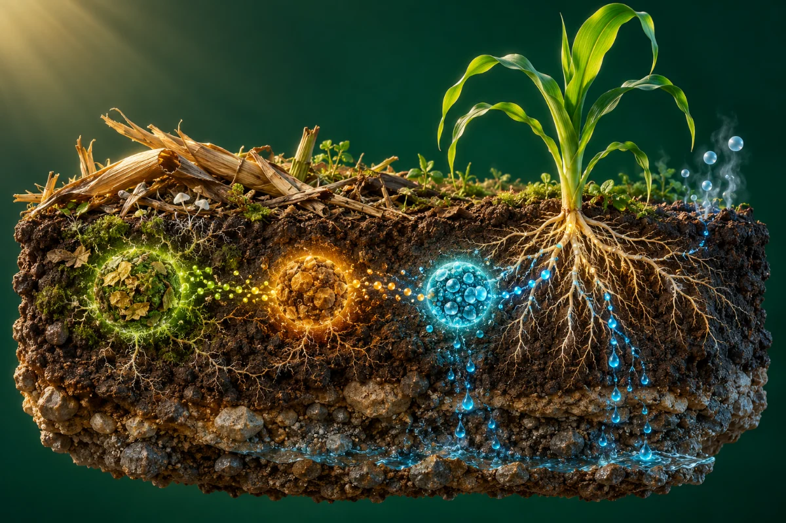

# 土壤中的氮素转化

**[在线演示](https://lidong-huang.github.io/plant-nutrition-lab/lessons/nitrogen.html)** · [独立 HTML](../../dist/downloads/nitrogen.html) · [课程目录](../README.md)

看清矿化、硝化、氨挥发、硝态氮淋洗与反硝化的条件和去向。

步骤：氮的形态 → 有机氮矿化 → 尿素水解 → 硝化 → 吸收与保留 → 氨挥发 → 硝态氮淋洗 → 反硝化 → 三类损失对比。

[内容与模型说明](../../docs/氮素转化机理.md) · [课件源码](../../dist/lessons/nitrogen.html)
