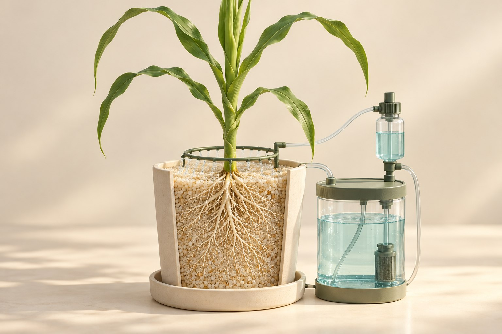

# 砂培 · 自动砂面浇灌

**[在线演示](https://lidong-huang.github.io/plant-nutrition-lab/lessons/sand-culture.html)** · [独立 HTML](../../dist/downloads/sand-culture.html) · [课程目录](../README.md)

跟随气压驱动的供液、回液与补液循环，完成独立的磷处理。

步骤：问题与处理 → 洗砂与装盆 → 配液与配平 → 辨认液路 → 加压喷灌 → 卸压与补液 → 随机与养护 → 成熟收获与千粒重 → 比较与结论。

[内容与模型说明](../../docs/磷效应培养试验.md) · [课件源码](../../dist/lessons/sand-culture.html)
