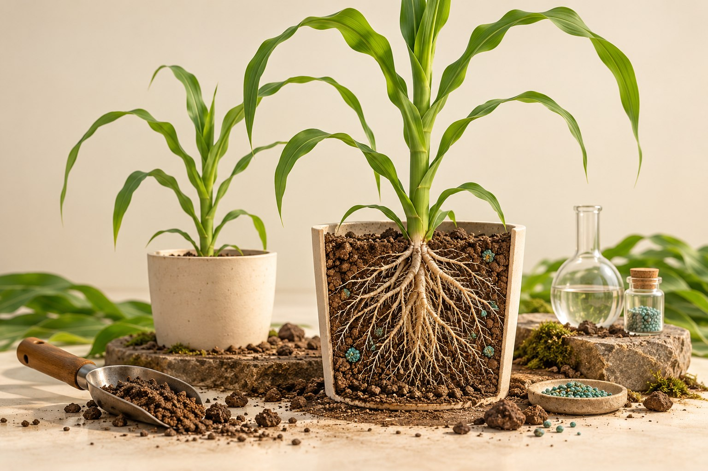

# 土培 · 玉米磷肥效应

**[在线演示](https://lidong-huang.github.io/plant-nutrition-lab/lessons/soil-culture.html)** · [独立 HTML](../../dist/downloads/soil-culture.html) · [课程目录](../README.md)

从选土、混肥到称重补水，用玉米生长与吸磷量评价磷效应。

步骤：问题与对照 → 取土与测定 → 磷处理与配平 → 装盆与定苗 → 随机与重复 → 称重与补水 → 成熟收获与千粒重 → 计算与解释。

[内容与模型说明](../../docs/磷效应培养试验.md) · [课件源码](../../dist/lessons/soil-culture.html)
