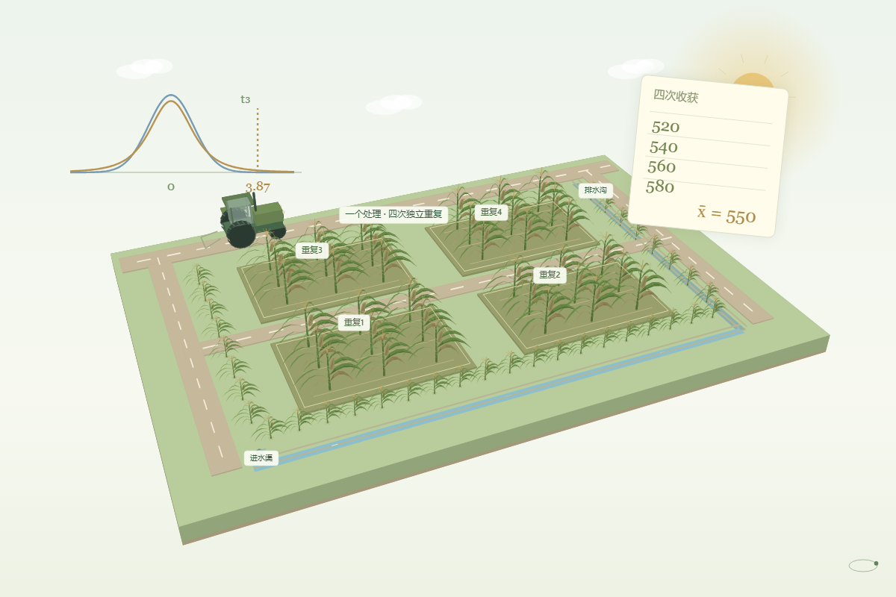

# 这次玉米产量显著提高了吗？

**[在线演示](https://lidong-huang.github.io/plant-nutrition-lab/lessons/trial-story.html)** · [独立 HTML](../../dist/downloads/trial-story.html) · [课程目录](../README.md)

从往年小区的产量汇总开始，比较均值分布，联系标准化与积分表，再用t分布判断本次产量。

步骤：历史收获 → 四个小区 → 均值的波动 → 标准化与概率 → 作出判断。

[内容与模型说明](../../docs/玉米产量互动闯关.md) · [课件源码](../../dist/lessons/trial-story.html)
