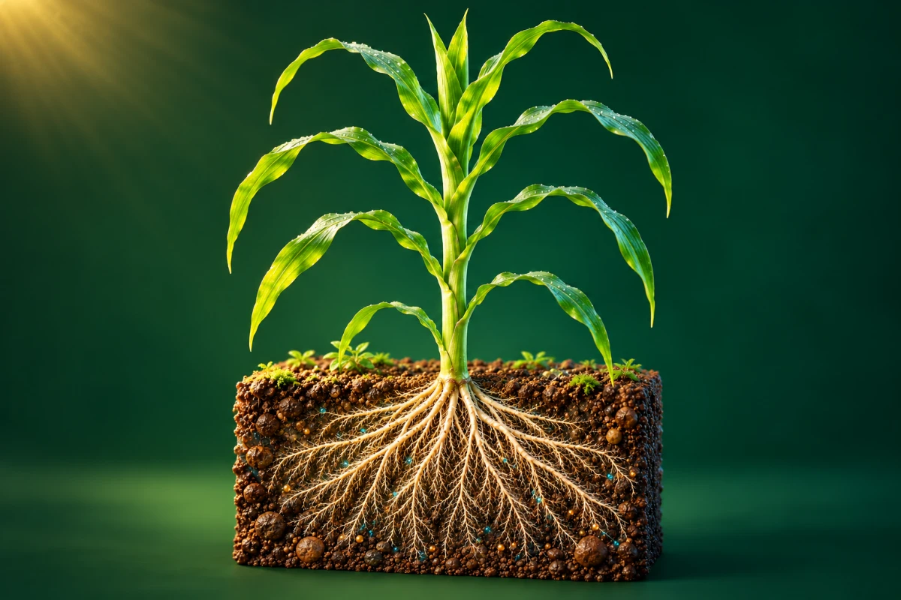

# 根系如何吸收养分

**[在线演示](https://lidong-huang.github.io/plant-nutrition-lab/lessons/uptake.html)** · [独立 HTML](../../dist/downloads/uptake.html) · [课程目录](../README.md)

观察玉米节根、侧根和根毛，跟随养分进入植株。

步骤：土壤溶液 → 根表迁移 → 跨膜吸收 → 向上运输。

[内容与模型说明](../../docs/玉米根系模型.md) · [课件源码](../../dist/lessons/uptake.html)
